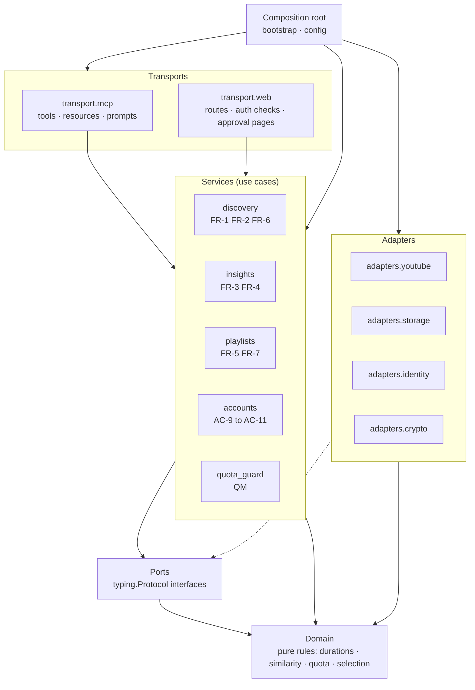

# 0003. Use a layered ports-and-adapters architecture

- **Status:** Accepted
- **Date:** 2026-11-28
- **Decision note:** [`brain/areas/decision-layered-architecture.md`](../../brain/areas/decision-layered-architecture.md)
- **Requirements:** SE-2, SE-3, SE-6, MT-1, IF-10, SL-1, PT-1

## Context
youtube-sieve will talk to the YouTube Data API, Google sign-in and a database, and serve both an MCP endpoint and browser pages. IF-10 and SE-6 require YouTube behind a replaceable provider interface; MT-1 forbids business logic in the MCP transport and asks for constructor injection; SL-1 requires a stateless application tier; PT-1 requires configuration from the environment. Only the pure domain layer exists so far.

## Decision
Arrange the code as **ports and adapters in six layers**, with dependencies pointing inward only:



| Layer | Package | May import |
|---|---|---|
| Domain | `youtube_sieve.domain` | standard library only |
| Ports | `youtube_sieve.ports` | domain |
| Services | `youtube_sieve.services` | domain, ports |
| Adapters | `youtube_sieve.adapters.{youtube,storage,identity,crypto}` | domain, ports, their own third-party library |
| Transports | `youtube_sieve.transport.{mcp,web}` | services, and domain and port types |
| Composition root | `youtube_sieve.bootstrap`, `youtube_sieve.config` | everything |

Rules:
- No layer imports one above it. Services never import adapters, transports, FastAPI, the MCP SDK, the HTTP client or a database driver.
- Transports validate input, call one service method and map the result or error; they hold no business logic.
- Only the composition root constructs adapters; services receive ports through their constructors.
- Settings are one typed object loaded from the environment and passed in.
- No module-level state holding user data.
- Every adapter has a fake implementing the same port, for tests.

Planned package tree:

```
src/youtube_sieve/
  domain/        ports/        services/
  adapters/{youtube,storage,identity,crypto}/
  transport/{mcp,web}/
  config.py      bootstrap.py      __main__.py
```

## Consequences
- Services and domain are tested with fakes, without network or database; adapters are tested against mocked HTTP or a test database.
- More small modules and interfaces than a flat design.
- The import rules should be enforced in CI rather than by review alone (#57).
- Later ADRs fill in the layers: tech stack (0004), YouTube provider interface (0005), storage (0006).
