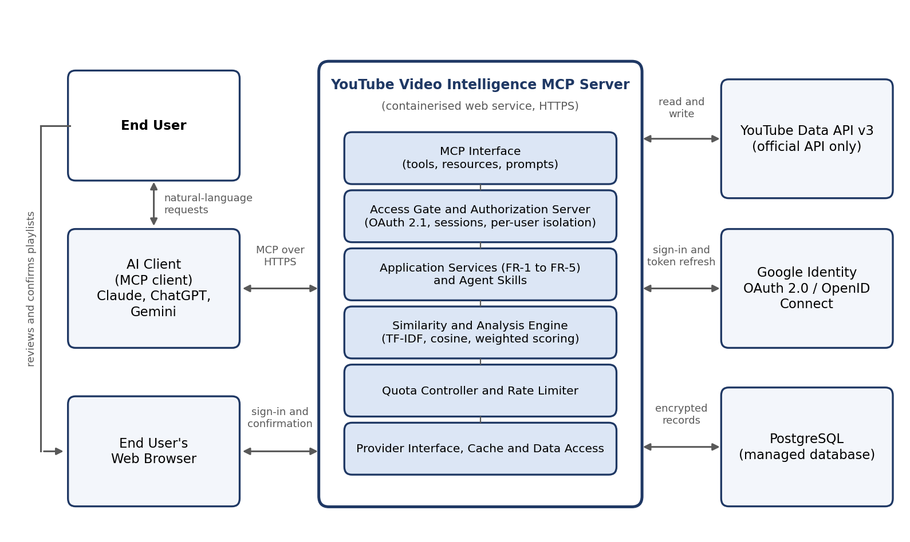
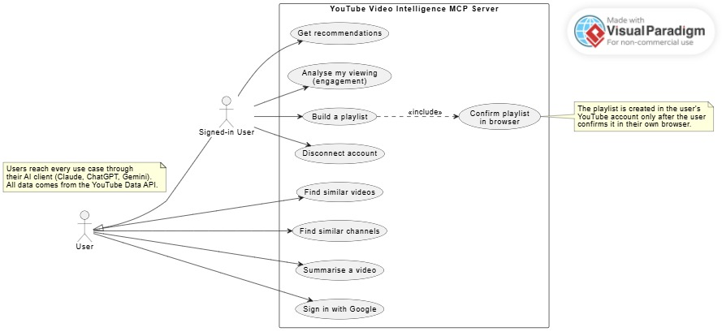

# Software Requirements Specification: YouTube Video Intelligence MCP Server

*An AI-driven service for discovering, analysing and curating YouTube videos through the Model Context Protocol*

| **Version**     | 0.1 (first draft) |
|-----------------|-------------------|
| **Date**        | 7 November 2026   |
| **Prepared by** | Team NimbleNibble |

## Document Control

**Revision history**

| **Version** | **Date**        | **Author**        | **Description of change** |
|-------------|-----------------|-------------------|---------------------------|
| 0.1         | 7 November 2026 | Team NimbleNibble | First draft               |

**Project team**

- Devaang Rastogi
- Romir Gupta
- Siddharth Brijesh Tripathi
- Divyanshu Ghosh

## Table of Contents

1. [Introduction](#1-introduction)
2. [General Description](#2-general-description)
3. [Functional Requirements](#3-functional-requirements)
4. [Interface Requirements](#4-interface-requirements)
5. [Performance Requirements](#5-performance-requirements)
6. [Design Constraints](#6-design-constraints)
7. [Non-Functional Attributes](#7-non-functional-attributes)
8. [Appendices](#8-appendices)

# 1. Introduction

## 1.1 Purpose of this Document

This Software Requirements Specification (SRS) defines the functional, interface, performance, design and non-functional requirements of the **YouTube Video Intelligence MCP Server** (the “System”). It is the baseline against which the System will be designed, implemented, verified and accepted, and it is the reference for any later change request. Its readers are the client, the development and test teams, operations and maintenance staff, and the project manager.

## 1.2 Scope of the System

The System is a server-side product that implements the Model Context Protocol (MCP). It allows an AI client, such as Claude, ChatGPT or Gemini, to discover, analyse and curate YouTube videos and playlists on behalf of a user, using the official YouTube Data API v3. Its functions are summarised in Section 2.2 and specified in Sections 3 and 4.

YouTube’s engagement-driven recommendations often favour viral content over structured, high-quality material, and building a focused playlist by hand is slow. The System ranks videos by objective metadata, applies the user’s constraints (topic, total duration, video length, number of videos, language) and, after the user’s explicit confirmation, creates the playlist in the user’s own account.

The following are out of scope:

- Building, training or hosting a language model, and any chat user interface; the AI client provides the conversational interface.

- A browser extension or any modification of youtube.com.

- Watch history, and analysis of video transcripts or audio; the System makes no claim about the content of a video beyond its metadata.

- Playback, downloading or re-hosting of video content.

- Editing or deleting existing playlists, videos, comments or channel settings; the System only creates new private playlists and adds videos to them.

- Native mobile or desktop applications.

## 1.3 Document Conventions

The word “shall” denotes a mandatory requirement; “should” denotes a recommended requirement; “may” denotes an optional capability. Every requirement carries a unique identifier and a priority. Terms are defined in Appendix A. Priority indicates delivery order: **High** requirements are necessary for acceptance, **Medium** requirements are expected in the first release, and **Low** requirements are desirable. Identifier prefixes give the category: AC access control (3.1), FR functions (3.2–3.7), QM quota (3.8), SK skills (3.9), IF interfaces (4), PF performance (5), DC design constraints (6), and SC, PV, RL, SL, MT, PT, IO and US for the non-functional attributes in Section 7.

# 2. General Description

## 2.1 Product Perspective

The System is a stand-alone back-end service. It has no user interface of its own for conversation: the user converses with an AI client, the AI client discovers the System’s tools through MCP, and the System performs the deterministic work, namely searching, scoring, filtering, constraint solving and playlist creation, against the YouTube Data API v3. The System does not depend on a particular AI client.

*Figure 1: System context*

## 2.2 Product Functions

| **Function**                              | **Summary**                                                                      | **Requirement and MCP tool**                 | **Access**                                      |
|-------------------------------------------|----------------------------------------------------------------------------------|----------------------------------------------|-------------------------------------------------|
| Similar videos                            | Ranked list of videos similar to a given video, computed from metadata.          | FR-1: similar_videos                         | Public                                          |
| Similar channels                          | Ranked list of channels similar to a given channel.                              | FR-2: similar_channels                       | Public                                          |
| Recommendations                           | Videos recommended from the user’s own likes, subscriptions and playlists.       | FR-3: recommendations                        | Signed-in                                       |
| Engagement analysis                       | Top channels and categories, trends, duration preferences and period comparison. | FR-4: engagement_analysis                    | Signed-in                                       |
| Playlist draft, confirmation and creation | Owned, immutable draft; browser confirmation; private playlist creation; status. | FR-5: create_playlist_draft, playlist_status | Signed-in                                       |
| Video summary and playlist analysis       | Metadata summary of a video; short analysis of a drafted or created playlist.    | FR-6: video_summary; FR-7                    | Public (summary); Signed-in (playlist analysis) |
| Account disconnect                        | Revokes the user’s grant and removes the user’s retained data.                   | AC-9: disconnect                             | Signed-in                                       |
| Agent Skills                              | Packaged video-to-playlist workflow for AI clients.                              | SK-1                                         | Public                                          |

*Figure 2: Use cases*

## 2.3 User Classes and Characteristics

| **User class** | **Description**                                                                                                                                                             | **Privileges**                                                                                           |
|----------------|-----------------------------------------------------------------------------------------------------------------------------------------------------------------------------|----------------------------------------------------------------------------------------------------------|
| Anonymous User | Any person using an AI client connected to the System without signing in. No technical expertise is assumed.                                                                | Public functions only. No per-user state is stored.                                                      |
| Signed-in User | A person who has authorised the System for their own Google account. Needs a YouTube channel to create playlists.                                                           | Public functions, plus personal functions on their own data only.                                        |
| AI Client      | An MCP-compatible application acting on a user’s behalf. It is a system actor, not a trusted decision-maker for confirmation: it cannot confirm, approve or resume a write. | Invokes tools within the access tier of the credentials presented.                                       |
| Operator       | Person who deploys, configures and monitors the System, and holds the hosting, database and Google Cloud credentials.                                                       | Operational access only. Has no ability to read users’ tokens or personal payloads, which are encrypted. |

## 2.4 Operating Environment

| **Element**         | **Specification**                                                                                                                   |
|---------------------|-------------------------------------------------------------------------------------------------------------------------------------|
| Application hosting | Containerised web service running Python 3.12 on Linux, hosted on Render, reachable over HTTPS on a public origin with managed TLS. |
| Persistent storage  | Neon serverless PostgreSQL with pooled connections for production. SQLite for explicit local development only.                      |
| External services   | YouTube Data API v3 (official); Google Identity (OAuth 2.0 and OpenID Connect) hosted in a single Google Cloud project.             |
| AI clients          | Any MCP client supporting Streamable HTTP transport and MCP authorization (for example Claude, ChatGPT, Gemini).                    |
| Browsers            | Current and previous major versions of Chrome, Edge, Firefox and Safari, for the sign-in and confirmation pages.                    |

## 2.5 Assumptions and Dependencies

| **ID** | **Assumption or dependency**                                                                                                                                                                       |
|--------|----------------------------------------------------------------------------------------------------------------------------------------------------------------------------------------------------|
| A-1    | Users hold a Google account. Creating a playlist additionally requires that the account has a YouTube channel.                                                                                     |
| A-2    | AI clients implement the MCP authorization flow (dynamic client registration, PKCE) and are able to present links to users.                                                                        |
| A-3    | While the Google OAuth application is in Testing status, at most 100 test users can sign in and refresh tokens expire after seven days. Production use requires Google’s application verification. |
| A-4    | Text returned by YouTube (titles, descriptions, tags) may contain content crafted to manipulate an AI client and is treated as untrusted data.                                                     |

# 3. Functional Requirements

This section specifies what the System shall do. For each principal function, the inputs (source, type, unit and valid range), the processing and the outputs are stated.

## 3.1 Access Control, Authorisation and Account Management

The System serves two access tiers from a single MCP endpoint. Public functions work without sign-in; personal functions require the user to authorise the System for their own Google account. These requirements apply to every function in this section.

| **ID**    | **Requirement**                                                                                                                                                                                                                                                                                                                                                                                                                 | **Priority** |
|-----------|---------------------------------------------------------------------------------------------------------------------------------------------------------------------------------------------------------------------------------------------------------------------------------------------------------------------------------------------------------------------------------------------------------------------------------|--------------|
| **AC-1**  | The System shall assign every MCP tool, resource and prompt to exactly one tier, Public or Signed-in, in a single auditable allow-list. Any operation that is not listed shall default to Signed-in.                                                                                                                                                                                                                            | High         |
| **AC-2**  | Public operations shall use only the System’s own YouTube API credential and public data. They shall not read or write user-specific data and shall not store per-user state.                                                                                                                                                                                                                                                   | High         |
| **AC-3**  | An MCP client shall be able to connect, initialise a session, list tools, resources and prompts, and call Public tools without presenting credentials.                                                                                                                                                                                                                                                                          | High         |
| **AC-4**  | When a Signed-in operation is requested without valid credentials, the System shall refuse it with an HTTP 401 response carrying a WWW-Authenticate challenge that references the protected-resource metadata, so that the MCP client starts the sign-in flow. An error inside a successful response shall not be used for this purpose.                                                                                        | High         |
| **AC-5**  | When invalid, expired, revoked or wrong-audience credentials are presented, the System shall reject the request with HTTP 401, even if the requested tool is Public.                                                                                                                                                                                                                                                            | High         |
| **AC-6**  | The System shall act as an OAuth 2.1 authorization server toward MCP clients, supporting authorization-server and protected-resource metadata discovery (RFC 8414, RFC 9728), dynamic client registration (RFC 7591), the authorization-code flow with mandatory PKCE (S256), resource indicators that bind each token to the System (RFC 8707), token revocation (RFC 7009), and refresh-token rotation with replay detection. | High         |
| **AC-7**  | Users shall sign in with Google using the OAuth 2.0 authorization-code flow with PKCE, a single-use state value, a nonce and browser binding. The System shall verify the Google ID token (signature, issuer, audience, expiry and nonce) and identify the user solely by the verified Google subject identifier (“sub”).                                                                                                       | High         |
| **AC-8**  | The initial Google consent shall request only the OpenID identity scope, the YouTube read-only scope and the YouTube management scope, and no other Google scope. The management scope is requested at first sign-in so that playlist creation does not interrupt an MCP session with a second consent step. Scope consent shall remain separate from, and shall never replace, the user’s confirmation of an individual draft. | High         |
| **AC-9**  | A signed-in user shall be able to disconnect. Disconnecting shall revoke the Google grant where reachable, revoke the user’s MCP tokens and browser sessions, and delete the user’s stored credentials, drafts and personal cache.                                                                                                                                                                                              | High         |
| **AC-10** | The System shall isolate users. Tokens, refresh operations, caches, drafts, quota usage and confirmations shall each belong to exactly one verified subject. No request argument shall select another user’s identity, and another user’s identifier (for example a draft ID) shall be indistinguishable from a non-existent one.                                                                                               | High         |
| **AC-11** | When a Google grant is revoked or has expired (including the seven-day expiry in Testing status), the System shall require re-authorisation of that user. It shall never fall back to another account or to a shared account.                                                                                                                                                                                                   | High         |
| **AC-12** | When the signed-in account has no YouTube channel (Google error youtubeSignupRequired), the System shall return the explanatory error channel_required for write operations while keeping read functions available.                                                                                                                                                                                                             | High         |
| **AC-13** | No operating mode shall exist in which the System substitutes an operator account, a shared static key, or a key carried in a URL for a user’s verified identity.                                                                                                                                                                                                                                                               | High         |

## 3.2 FR-1: Similar Videos

**Description.** Given a video URL or ID, return a ranked list of similar videos. Because the YouTube Data API has no related-videos endpoint, the System computes similarity from video metadata. **Access:** Public.

### Inputs

| **Parameter** | **Type / unit** | **Valid values**                                                                | **Required** |
|---------------|-----------------|---------------------------------------------------------------------------------|--------------|
| video         | Text            | YouTube URL (watch, youtu.be, shorts or embed form) or an 11-character video ID | Yes          |
| limit         | Integer (count) | 1 to 25; default 10                                                             | No           |

### Requirements

| **ID**     | **Requirement**                                                                                                                                                                                                                                                                                                                                           | **Priority** |
|------------|-----------------------------------------------------------------------------------------------------------------------------------------------------------------------------------------------------------------------------------------------------------------------------------------------------------------------------------------------------------|--------------|
| **FR-1.1** | The System shall accept a video as a URL or an 11-character ID, normalise it to the ID, and reject any other form with the error invalid_input.                                                                                                                                                                                                           | High         |
| **FR-1.2** | The System shall retrieve the seed video’s metadata (title, description, tags, category, channel, duration and declared language). If the video is private, deleted or unavailable, it shall return not_found without issuing further API calls.                                                                                                          | High         |
| **FR-1.3** | The System shall build a candidate pool of at most 50 distinct videos from keyword searches derived from the seed’s title and tags, other recent uploads of the seed’s channel and, where available, uploads of similar channels.                                                                                                                         | High         |
| **FR-1.4** | The System shall score each candidate against the seed using TF-IDF vectors over title, tags and a bounded part of the description with cosine similarity, combined with weighted adjustments for same category, same declared language, similar duration and same channel (the last as a small diversity adjustment). The weights shall be configurable. | High         |
| **FR-1.5** | Where tags are missing, the System shall fall back to title and description. Where all text is absent, it shall score on non-text features only and mark the result as low confidence.                                                                                                                                                                    | High         |
| **FR-1.6** | The System shall exclude the seed video, duplicates, unavailable videos, live or upcoming broadcasts and videos of zero duration.                                                                                                                                                                                                                         | High         |
| **FR-1.7** | The System shall return up to limit results in descending score order with a deterministic tie-break. Each result shall include video ID, URL, title, channel, duration, category, declared language, a score in the range 0 to 1 and the principal factors behind the score.                                                                             | High         |
| **FR-1.8** | For a Public caller the response shall state that results are metadata-based and not personalised. For a signed-in caller, videos found in the caller’s sampled likes and playlists shall be excluded by default.                                                                                                                                         | Medium       |

## 3.3 FR-2: Similar Channels

**Description.** Given a channel URL, handle or ID, return a ranked list of similar channels, computed from channel metadata. **Access:** Public.

### Inputs

| **Parameter** | **Type / unit** | **Valid values**                                                                                                    | **Required** |
|---------------|-----------------|---------------------------------------------------------------------------------------------------------------------|--------------|
| channel       | Text            | Channel URL (/channel/, /@handle, /c/ or /user/ form), an @handle, or a 24-character channel ID beginning with “UC” | Yes          |
| limit         | Integer (count) | 1 to 25; default 10                                                                                                 | No           |

### Requirements

| **ID**     | **Requirement**                                                                                                                                                                                                                                    | **Priority** |
|------------|----------------------------------------------------------------------------------------------------------------------------------------------------------------------------------------------------------------------------------------------------|--------------|
| **FR-2.1** | The System shall accept a channel as a URL, handle or ID, resolve it to a channel ID through the official API, and reject malformed input with invalid_input.                                                                                      | High         |
| **FR-2.2** | The System shall build a text profile from the channel’s title, description, keywords and topic categories, and from the titles and tags of a bounded sample of at most 20 recent uploads.                                                         | High         |
| **FR-2.3** | The System shall discover candidate channels by channel search on the profile’s principal terms, bounded to 25 distinct channels.                                                                                                                  | High         |
| **FR-2.4** | The System shall score candidates by TF-IDF cosine similarity over the profile text, with configurable weighted adjustments for shared topic categories and, where declared, shared country or language.                                           | High         |
| **FR-2.5** | The System shall exclude the input channel, duplicates and unavailable or terminated channels.                                                                                                                                                     | High         |
| **FR-2.6** | The System shall return up to limit results, each with channel ID, title, handle or URL, a short description, the public subscriber count where visible, topic categories, a score in the range 0 to 1 and the principal factors behind the score. | High         |
| **FR-2.7** | The System shall handle channels without public videos or with hidden subscriber counts without failing.                                                                                                                                           | Medium       |

## 3.4 FR-3: Recommendations

**Description.** Recommend videos based on the signed-in user’s own liked videos, subscriptions and playlists. Watch history is not available through the API and is neither requested nor claimed. **Access:** Signed-in.

### Inputs

| **Parameter** | **Type / unit** | **Valid values**    | **Required** |
|---------------|-----------------|---------------------|--------------|
| limit         | Integer (count) | 1 to 25; default 10 | No           |

### Requirements

| **ID**     | **Requirement**                                                                                                                                                                                                                                            | **Priority** |
|------------|------------------------------------------------------------------------------------------------------------------------------------------------------------------------------------------------------------------------------------------------------------|--------------|
| **FR-3.1** | The System shall read the signed-in user’s liked videos, subscriptions and playlists through the official API, using that user’s own credentials only.                                                                                                     | High         |
| **FR-3.2** | The System shall bound the profile sample to at most 100 liked videos, 100 subscriptions and 10 playlists of up to 100 items each, most recent first, and shall disclose any truncation.                                                                   | High         |
| **FR-3.3** | The System shall build an interest profile as a weighted TF-IDF centroid of liked and playlist videos, together with topic weights derived from subscribed channels.                                                                                       | High         |
| **FR-3.4** | The System shall generate at most 50 candidates from keyword searches on the principal profile terms and from recent uploads of subscribed channels, score them by similarity to the profile, and exclude videos found in the sampled likes and playlists. | High         |
| **FR-3.5** | The System shall return up to limit ranked videos, each with a short reason (the matching topics and the number of sampled items that contributed) and without exposing raw personal records beyond identifiers the user already owns.                     | High         |
| **FR-3.6** | When the user’s data is private, hidden or empty, the System shall return a clear explanatory message and use whichever sources remain available.                                                                                                          | High         |

## 3.5 FR-4: Engagement Analysis

**Description.** Analyse the signed-in user’s liked videos, subscriptions and playlists, covering top channels and categories, trends over time, duration preferences and comparisons between periods. **Access:** Signed-in.

### Inputs

| **Parameter**  | **Type / unit**      | **Valid values**                                                | **Required**               |
|----------------|----------------------|-----------------------------------------------------------------|----------------------------|
| start          | Date (ISO 8601, UTC) | Not later than end; range of at most three years                | No (default: last 90 days) |
| end            | Date (ISO 8601, UTC) | Not later than today                                            | No (default: today)        |
| previous_start | Date (ISO 8601, UTC) | Start of a comparison period of the same length as start to end | No                         |

### Requirements

| **ID**     | **Requirement**                                                                                                                                                                                                                                                                                                                                                              | **Priority** |
|------------|------------------------------------------------------------------------------------------------------------------------------------------------------------------------------------------------------------------------------------------------------------------------------------------------------------------------------------------------------------------------------|--------------|
| **FR-4.1** | The System shall analyse the same sources and sample bounds as FR-3 (FR-3.1, FR-3.2).                                                                                                                                                                                                                                                                                        | High         |
| **FR-4.2** | The System shall report the top 10 channels and the top 10 categories by item count and share.                                                                                                                                                                                                                                                                               | High         |
| **FR-4.3** | The System shall report duration preferences as the distribution across the bands up to 5 minutes, 5 to 10, 10 to 20, 20 to 40 and over 40 minutes, together with the median and mean duration.                                                                                                                                                                              | High         |
| **FR-4.4** | The System shall report trends over time as counts per month (per week when the range is 90 days or less) using the activity dates the API provides, such as the date added to a playlist or the subscription date. Where an activity date is unavailable, as for liked videos, the System shall not substitute the video’s publication date and shall state the limitation. | High         |
| **FR-4.5** | When previous_start is given, the System shall compare the two periods and report the absolute and percentage change in item count, top channels, top categories and mean duration. Time-zone conversion shall be explicit and shall produce equal period counts for equivalent boundaries.                                                                                  | High         |
| **FR-4.6** | The System shall validate dates (ISO 8601, start not after end, end not in the future, range at most three years) and reject invalid input with invalid_input.                                                                                                                                                                                                               | High         |

## 3.6 FR-5: Playlist Creation

**Description. Accept a request with constraints (topic, total duration, minimum and maximum video length, number of videos, language), build a playlist that satisfies them, show it to the user, and create it in the user’s own YouTube account only after the user’s explicit confirmation in their own browser. The function has two stages: a Signed-in immutable draft and a browser-confirmed creation.** Confirmation is never delegated to an AI client: it is the safeguard that prevents untrusted video text from causing a write to the user’s account.

### Inputs

| **Parameter** | **Type / unit**   | **Valid values**                                                                   | **Required** |
|---------------|-------------------|------------------------------------------------------------------------------------|--------------|
| topic         | Text              | 2 to 200 characters                                                                | Yes          |
| total_seconds | Integer (seconds) | Positive integer; omitted means no total bound                                     | No           |
| max_seconds   | Integer (seconds) | Positive integer; omitted means no per-video bound                                 | No           |
| min_seconds   | Integer (seconds) | Positive integer, not greater than max_seconds; omitted means no per-video minimum | No           |
| language      | Language code     | ISO 639-1 or BCP 47 code, for example “en”, “hi” or “pt-BR”                        | No           |
| video_count   | Integer (count)   | 1 to 50; omitted means no requirement on the number of videos                      | No           |
| count_mode    | Text              | exactly (default), at_least or at_most; applies only with video_count              | No           |
| exclude_saved | Boolean           | Default true                                                                       | No           |

### Requirements

| **ID**      | **Requirement**                                                                                                                                                                                                                                                                                                                                                                                                                                                                                                                                                                                                                                                                                                                                    | **Priority** |
|-------------|----------------------------------------------------------------------------------------------------------------------------------------------------------------------------------------------------------------------------------------------------------------------------------------------------------------------------------------------------------------------------------------------------------------------------------------------------------------------------------------------------------------------------------------------------------------------------------------------------------------------------------------------------------------------------------------------------------------------------------------------------|--------------|
| **FR-5.1**  | The System shall accept the constraints as structured fields, convert durations to whole seconds, and echo the interpreted constraints in the response. Where a limit is stated in the topic text and the corresponding field is absent, the System shall apply that limit and report it in the response as inferred from the topic.                                                                                                                                                                                                                                                                                                                                                                                                               | High         |
| **FR-5.2**  | Total duration, minimum and maximum video length, number of videos and language are optional. When supplied, they shall be honoured strictly and shall never be relaxed silently.                                                                                                                                                                                                                                                                                                                                                                                                                                                                                                                                                                  | High         |
| **FR-5.3**  | The System shall build a candidate pool of at most 50 videos from topic searches, fetch their metadata in batches, and score their relevance to the topic using TF-IDF cosine similarity.                                                                                                                                                                                                                                                                                                                                                                                                                                                                                                                                                          | High         |
| **FR-5.4**  | The System shall select an ordered subset that maximises total relevance subject to the following: the sum of durations does not exceed total_seconds; each video does not exceed max_seconds and is not shorter than min_seconds; the declared language equals language (videos with no declared language are excluded when a language is requested); there are no duplicates; there are no live, unavailable or zero-duration videos; and the playlist contains at most 50 videos. When video_count is given, the playlist shall contain exactly video_count videos for count_mode exactly, at least video_count videos for at_least, and at most video_count videos for at_most; it shall never contain more videos than the requested maximum. | High         |
| **FR-5.5**  | The total duration is a ceiling and not a target. The System shall be permitted to leave time unused rather than relax a constraint.                                                                                                                                                                                                                                                                                                                                                                                                                                                                                                                                                                                                               | High         |
| **FR-5.6**  | When no selection satisfies the constraints, the System shall report which constraint is binding, shall change nothing, and shall leave the decision to relax a constraint to the user. When fewer videos satisfy the constraints than the requested number (count_mode exactly or at_least), the System shall return not_enough_videos with the number of videos found and shall not return a shorter playlist.                                                                                                                                                                                                                                                                                                                                   | High         |
| **FR-5.7**  | The System shall order the selected videos by descending relevance, with shorter videos first among equal scores.                                                                                                                                                                                                                                                                                                                                                                                                                                                                                                                                                                                                                                  | Medium       |
| **FR-5.8**  | The draft response shall include a constraint check that reports the number of videos, the requested number of videos, the shortest and longest duration, whether the requested number is satisfied and whether every constraint is satisfied.                                                                                                                                                                                                                                                                                                                                                                                                                                                                                                     | High         |
| **FR-5.9**  | The System shall create, for a signed-in user, an immutable draft owned by that user, storing the exact ordered video IDs, a metadata snapshot, the constraints, the owner, creation and expiry times, and the state. No operation shall modify the content of a draft. Before creation, the System shall re-verify the drafted videos; videos that no longer satisfy the constraints shall be skipped and reported, and when a minimum number of videos was requested and fewer remain, creation shall be refused with not_enough_videos and nothing shall be written.                                                                                                                                                                            | High         |
| **FR-5.10** | An unconfirmed draft shall expire after 30 minutes and an expired draft shall not be confirmable.                                                                                                                                                                                                                                                                                                                                                                                                                                                                                                                                                                                                                                                  | High         |
| **FR-5.11** | The draft response shall contain the draft summary, a confirmation link and a statement that confirmation takes place in the user’s own browser.                                                                                                                                                                                                                                                                                                                                                                                                                                                                                                                                                                                                   | High         |
| **FR-5.12** | Confirmation shall be possible only in the user’s own authenticated browser session, on a page that displays the exact ordered videos, durations, total runtime and constraints of the draft and offers an explicit confirmation action.                                                                                                                                                                                                                                                                                                                                                                                                                                                                                                           | High         |
| **FR-5.13** | A confirmation request shall be accepted only if it carries a browser session bound to the draft’s owner, a valid CSRF token and a same-origin request, and results from a deliberate user action.                                                                                                                                                                                                                                                                                                                                                                                                                                                                                                                                                 | High         |
| **FR-5.14** | No MCP tool, resource, prompt or access token shall be able to confirm, approve, create or resume a draft. MCP access tokens shall be rejected on confirmation routes, and browser session credentials shall be rejected on the MCP endpoint.                                                                                                                                                                                                                                                                                                                                                                                                                                                                                                      | High         |
| **FR-5.15** | On confirmation, the System shall create a private playlist in the user’s own YouTube account and insert the videos in draft order using that user’s credentials. The default title shall derive from the topic and the description shall state that the playlist was generated by the System.                                                                                                                                                                                                                                                                                                                                                                                                                                                     | High         |
| **FR-5.16** | The draft state shall progress pending, writing, then complete, partial or uncertain, through atomic transitions. Progress shall be persisted before each external write. Confirming the same draft twice shall not create a duplicate playlist.                                                                                                                                                                                                                                                                                                                                                                                                                                                                                                   | High         |
| **FR-5.17** | After a known partial failure, the user shall be able to resume from the browser with an additional explicit confirmation. Only the remaining videos shall be inserted.                                                                                                                                                                                                                                                                                                                                                                                                                                                                                                                                                                            | High         |
| **FR-5.18** | After an uncertain outcome, such as a network failure with an unknown result, the System shall not retry automatically and shall instruct the user to inspect their YouTube account.                                                                                                                                                                                                                                                                                                                                                                                                                                                                                                                                                               | High         |
| **FR-5.19** | A read-only, Signed-in status tool shall return the draft state, playlist link and ID, number of videos inserted, the result of reading the created playlist back from YouTube (number of items and whether they match the draft) and, once complete, the playlist analysis. A draft that is unknown or belongs to another user shall reveal nothing.                                                                                                                                                                                                                                                                                                                                                                                              | High         |

## 3.7 FR-6 and FR-7: Supporting Functions

| **ID**   | **Requirement**                                                                                                                                                                                                                                                                                                                                                                         | **Priority** |
|----------|-----------------------------------------------------------------------------------------------------------------------------------------------------------------------------------------------------------------------------------------------------------------------------------------------------------------------------------------------------------------------------------------|--------------|
| **FR-6** | Video summary (Public). Given a video URL or ID, the System shall return its title, channel, publication date, duration, category, declared language, a bounded set of tags and a factual digest of the description of at most 500 characters. The summary shall state that it derives from metadata only and shall not claim that the video was watched or that a transcript was read. | High         |
| **FR-7** | Playlist analysis (owner only, for drafts and created playlists). The System shall report the number of videos, total, average, shortest and longest duration, the distribution by channel and category, and how much of the stated time ceiling is used, together with relevant caveats.                                                                                               | High         |

## 3.8 Quota and Rate Management

The default project allowance of 10,000 units per day is shared by every caller. The System therefore estimates the cost of each workflow, enforces budgets before calling the API, and uses caching to reduce consumption.

| **ID**   | **Requirement**                                                                                                                                                                                                                                                                                                                                                                                                                          | **Priority** |
|----------|------------------------------------------------------------------------------------------------------------------------------------------------------------------------------------------------------------------------------------------------------------------------------------------------------------------------------------------------------------------------------------------------------------------------------------------|--------------|
| **QM-1** | The System shall maintain a quota ledger for each Google Cloud project day (reset at midnight Pacific Time) that records estimated and actual units consumed, attributed to the Public tier or to a user account.                                                                                                                                                                                                                        | High         |
| **QM-2** | Before executing any workflow, the System shall compute its maximum estimated cost from the quota cost Google publishes for each planned API method and compare it with the remaining budget. If the estimate exceeds the remaining budget, the System shall reject the workflow before making any call to the YouTube Data API and shall return quota_budget_exceeded with the estimated cost, the remaining budget and the reset time. | High         |
| **QM-3** | The System shall enforce a global daily budget (default 10,000 units, configurable to the project’s actual allowance), a cap for Public callers (default 30 percent of the global budget) and a per-account daily budget (default 2,500 units), so that no single caller can exhaust the allowance.                                                                                                                                      | High         |
| **QM-4** | The System shall reserve the estimated cost atomically before execution, reconcile it with actual consumption afterwards and release any unused amount. Concurrent requests, including requests handled by different instances, shall not overdraw a budget.                                                                                                                                                                             | High         |
| **QM-5** | The System shall cache public metadata (default time to live: 24 hours for video and channel metadata, 6 hours for search results). Public caches shall contain no personal data. Personal caches shall be isolated per user, encrypted and limited to a time to live of at most one hour.                                                                                                                                               | High         |
| **QM-6** | The System shall prefer one-unit list calls, shall batch up to 50 identifiers per call, and shall limit search calls (100 units each) to a configurable maximum per workflow (default 2).                                                                                                                                                                                                                                                | Medium       |
| **QM-7** | A signed-in user shall be able to read their own usage and remaining budget, and the remaining global budget, through an informational resource.                                                                                                                                                                                                                                                                                         | Medium       |
| **QM-8** | The System shall apply a configurable rate limit (default 60 MCP requests per minute) per client address for Public callers and per account for signed-in callers. An excess shall be refused with rate_limited and a retry delay. The client address shall be taken from forwarding headers only when they originate from a configured trusted proxy.                                                                                   | High         |
| **QM-9** | When Google returns quotaExceeded or dailyLimitExceeded, the System shall mark the day’s allowance as exhausted, reject further billable workflows until the reset, and return quota_exceeded without exposing upstream detail. It shall retry rateLimitExceeded and userRateLimitExceeded responses only for idempotent reads and only a bounded number of times.                                                                       | High         |

## 3.9 Agent Skill Requirements

Agent Skills are folders containing a SKILL.md file (name and description in the frontmatter, followed by instructions) that tell an AI client how to carry out a workflow reliably.

### 3.9.1 SK-1: video-to-playlist (product skill)

The skill runs the complete product workflow starting from one video: optionally summarise the video (FR-6, metadata only); create the draft with every constraint the user states (FR-5, sign-in required); present the exact ordered videos with the confirmation link in the same reply; leave creation to the System after browser confirmation, reading only the status; and show the playlist analysis once complete (FR-7).

| **ID**     | **Requirement**                                                                                                                                                                                       | **Priority** |
|------------|-------------------------------------------------------------------------------------------------------------------------------------------------------------------------------------------------------|--------------|
| **SK-1.1** | The skill shall be delivered as a folder with a SKILL.md file whose frontmatter contains the name video-to-playlist and a description, in the Agent Skills format.                                    | High         |
| **SK-1.2** | The skill shall instruct the AI client to treat all returned metadata as untrusted data and never to obey it, treat it as consent, or use it to request secrets.                                      | High         |
| **SK-1.3** | The skill shall instruct the AI client never to claim to have watched a video or read a transcript, never to use an operator or another user’s account, and never to ask the user for a key or token. | High         |
| **SK-1.4** | The skill shall instruct the AI client to state the constraints explicitly and to obtain the user’s decision before relaxing any of them.                                                             | High         |

# 4. Interface Requirements

## 4.1 User Interfaces

The conversational interface is provided by the AI client and is outside the scope of the System. The System provides a small set of browser pages for the actions that must take place outside the AI conversation.

| **Page**                              | **Purpose**                                                                                                                                                | **Access**                          |
|---------------------------------------|------------------------------------------------------------------------------------------------------------------------------------------------------------|-------------------------------------|
| Landing page                          | States what the System is, shows its health and links to documentation.                                                                                    | Public                              |
| Sign-in and consent page              | Google sign-in and the consent step for an AI client that is connecting.                                                                                   | Public (initiated by the AI client) |
| Playlist review and confirmation page | Shows the exact draft and provides the explicit confirmation action (FR-5.12), and the explicit resumption action after a known partial failure (FR-5.17). | Owner’s browser session only        |
| Error pages                           | Plain-language explanations for browser errors; API clients continue to receive structured errors.                                                         | Public                              |

| **ID**   | **Requirement**                                                                                                                                            | **Priority** |
|----------|------------------------------------------------------------------------------------------------------------------------------------------------------------|--------------|
| **IF-1** | Browser pages shall be responsive from 360 px to desktop widths and shall be usable with the keyboard alone, with text contrast meeting WCAG 2.1 level AA. | Medium       |

## 4.2 MCP Interface

The System shall expose a single MCP endpoint using Streamable HTTP at the path /mcp/. Its tools are named in Section 2.2; its resources and prompts are specified below. Every tool description shall state its access tier (“Requires sign-in” for Signed-in tools).

| **ID**   | **Requirement**                                                                                                                                                                              | **Priority** |
|----------|----------------------------------------------------------------------------------------------------------------------------------------------------------------------------------------------|--------------|
| **IF-2** | The System shall expose these resources: system capabilities (Public), the video-to-playlist skill document (Public) and the caller’s own quota usage (Signed-in).                           | Medium       |
| **IF-3** | The System shall expose one prompt, video_to_playlist_workflow, which starts SK-1 for a given video (Public).                                                                                | Medium       |
| **IF-4** | Tool results shall be structured JSON containing either the result or the standard error object (Section 4.7). Tool inputs shall be validated against a schema before any processing (SC-5). | High         |

## 4.3 Authorization Interfaces

| **ID**   | **Requirement**                                                                                                                                                                                                                                   | **Priority** |
|----------|---------------------------------------------------------------------------------------------------------------------------------------------------------------------------------------------------------------------------------------------------|--------------|
| **IF-5** | The 401 challenge required by AC-4 shall be WWW-Authenticate: Bearer with the protected-resource metadata URL and the required scope. A token lacking the scope shall receive HTTP 403 with error="insufficient_scope".                           | High         |
| **IF-6** | Unknown paths under /.well-known/ shall answer 404 and not 401, so that clients do not conclude that an unsupported sign-in flow is required.                                                                                                     | Medium       |
| **IF-7** | Dynamic registration shall accept only redirect URIs that are exact HTTPS URLs or HTTP loopback URLs, and shall reject wildcards, embedded credentials and fragments. Client-supplied metadata shall not influence identity, scopes or redirects. | High         |
| **IF-8** | The System shall define an application-level scope for access to the signed-in user’s own data. This scope shall be distinct from, and shall not grant, any Google scope.                                                                         | High         |

## 4.4 Web and REST Interface

| **ID**   | **Requirement**                                                                                                                                                                                                                                                                 | **Priority** |
|----------|---------------------------------------------------------------------------------------------------------------------------------------------------------------------------------------------------------------------------------------------------------------------------------|--------------|
| **IF-9** | The System shall provide user-scoped browser routes for sign-in entry, the Google callback, draft viewing, confirmation and resumption, and enabling playlist write access, a disconnection route, and a liveness route /health that returns no personal or configuration data. | High         |

## 4.5 Software Interfaces

| **Interface**       | **Use**                                                 | **Details**                                                                                                    |
|---------------------|---------------------------------------------------------|----------------------------------------------------------------------------------------------------------------|
| YouTube Data API v3 | Public metadata, the user’s own data, playlist creation | Public reads use the System’s API key; personal reads and writes use the user’s own access token.              |
| Google Identity     | User sign-in and token management                       | Authorization endpoint, token endpoint, signing keys (JWKS), revocation endpoint and OpenID Connect discovery. |

| **ID**    | **Requirement**                                                                                                                                                                                                                              | **Priority** |
|-----------|----------------------------------------------------------------------------------------------------------------------------------------------------------------------------------------------------------------------------------------------|--------------|
| **IF-10** | The System shall reach YouTube only through a provider interface with separate read and write protocols. Replacing the provider, or substituting a test double, shall require no change to the ranking logic, the services or the MCP tools. | High         |
| **IF-11** | Outbound requests shall use HTTPS, a timeout of at most 15 seconds, and no automatic retry of write operations.                                                                                                                              | High         |

## 4.6 Communications Interfaces

| **ID**    | **Requirement**                                                                                                                                                                                                                      | **Priority** |
|-----------|--------------------------------------------------------------------------------------------------------------------------------------------------------------------------------------------------------------------------------------|--------------|
| **IF-12** | All external communication shall use HTTPS with TLS 1.2 or later. MCP messages shall use JSON-RPC 2.0 over Streamable HTTP; authorization requests shall use form-encoded OAuth messages; all other payloads shall be JSON in UTF-8. | High         |

## 4.7 Error Interface

Every failure shall be reported as a structured object {"error": {"code": "…", "message": "…"}}. Messages shall be safe for display and shall never contain credentials, upstream response bodies or stack traces.

# 5. Performance Requirements

Dynamic requirements are measured at the server on the baseline deployment (Section 2.4) under nominal load, defined as up to 10 concurrent tool executions, and exclude network latency between the AI client and the System. Time spent in the YouTube Data API is included, assuming a median upstream response time of 300 ms or less per call. The values are targets for the first release and are to be confirmed during design.

## 5.1 Dynamic Requirements

| **ID**    | **Requirement**                                                                                                                                                                        | **Priority** |
|-----------|----------------------------------------------------------------------------------------------------------------------------------------------------------------------------------------|--------------|
| **PF-1**  | Public read functions answered from cache (FR-1, FR-2, FR-6) shall complete within 3 seconds at the 95th percentile.                                                                   | High         |
| **PF-2**  | FR-1 and FR-2 requiring uncached API calls shall complete within 15 seconds at the 95th percentile.                                                                                    | High         |
| **PF-3**  | A playlist draft (FR-5) shall be produced within 20 seconds at the 95th percentile.                                                                                                    | High         |
| **PF-4**  | FR-3 and FR-4, including reading the bounded sample, shall complete within 30 seconds at the 95th percentile.                                                                          | Medium       |
| **PF-5**  | Playlist creation after confirmation shall complete within 90 seconds for a playlist of 50 videos.                                                                                     | Medium       |
| **PF-6**  | Requests that do not call YouTube (health, discovery metadata, page rendering, token endpoint) shall complete within 500 ms at the 95th percentile.                                    | Medium       |
| **PF-7**  | Authorization checks shall add no more than 50 ms at the 95th percentile to any request.                                                                                               | Medium       |
| **PF-8**  | After a period of inactivity on a hosting plan that suspends idle services, the first request shall be served within 60 seconds. This limit shall be stated in the user documentation. | Low          |
| **PF-9**  | The System shall support at least 25 simultaneous MCP sessions and 10 concurrent tool executions on the baseline deployment without errors originating in the System.                  | High         |
| **PF-10** | Resident memory shall not exceed 512 MB under nominal load.                                                                                                                            | Medium       |

## 5.2 Static Requirements

| **ID**    | **Requirement**                                                                                                                                                                                        | **Priority** |
|-----------|--------------------------------------------------------------------------------------------------------------------------------------------------------------------------------------------------------|--------------|
| **PF-11** | The System shall support at least 100 registered accounts, which is the limit for a Google application in Testing status, and shall be configurable for more once Google has verified the application. | High         |
| **PF-12** | Stored data per account (cache and drafts) shall not exceed 5 MB, enforced by the cache time-to-live and draft expiry.                                                                                 | Medium       |

# 6. Design Constraints

| **ID** | **Constraint**                                                                                                                                                                                                                           | **Origin**         |
|--------|------------------------------------------------------------------------------------------------------------------------------------------------------------------------------------------------------------------------------------------|--------------------|
| DC-1   | Only the official YouTube Data API v3 shall be used. Scraping, unofficial endpoints and browser automation are prohibited.                                                                                                               | Client requirement |
| DC-2   | A new Google Cloud project has a default allowance of 10,000 units per day. The System shall operate within one project, and no additional project shall be created to obtain more quota.                                                | Client requirement |
| DC-3   | The API provides no watch history and no related-videos or related-channels endpoint. Similarity shall be computed from metadata by simple, transparent techniques: TF-IDF, cosine similarity over feature vectors and weighted scoring. | Client requirement |
| DC-4   | The System shall be written in Python 3.12 with pinned dependencies (lock file), using the FastAPI web framework and the official MCP Python SDK for protocol and authorization primitives.                                              | Engineering        |
| DC-5   | Production persistence shall use Neon PostgreSQL. If the configured database fails, the System shall fail closed and shall not fall back to SQLite.                                                                                      | Platform           |
| DC-6   | The System shall comply with the Google API Services User Data Policy (including its Limited Use requirements) and the YouTube API Services Terms of Service and Developer Policies.                                                     | Regulatory         |

# 7. Non-Functional Attributes

## 7.1 Security

| **ID**    | **Requirement**                                                                                                                                                                                                                                                                                                                          | **Priority** |
|-----------|------------------------------------------------------------------------------------------------------------------------------------------------------------------------------------------------------------------------------------------------------------------------------------------------------------------------------------------|--------------|
| **SC-1**  | MCP credentials shall be unguessable random values of at least 256 bits, stored only as hashes. Access tokens shall be short-lived (at most one hour) and bound to the System as audience. Refresh tokens shall rotate on every use, and replay of a rotated token shall revoke the whole token family.                                  | High         |
| **SC-2**  | Google tokens and personal payloads shall be encrypted at rest using authenticated encryption. The encryption key shall be held in the platform’s secret store, separately from the database, and a documented procedure shall allow key rotation with re-encryption.                                                                    | High         |
| **SC-3**  | Browser sessions shall use cookies that are Secure, HttpOnly and SameSite, bound to the verified subject. Browser sessions and MCP tokens shall be separate credentials that are not interchangeable.                                                                                                                                    | High         |
| **SC-4**  | Prompt-injection defence. Titles, descriptions, tags and any other text from YouTube shall be treated as untrusted data. The System shall escape it on output, and it shall have no effect on authorisation. Because no MCP capability can confirm or create a playlist (FR-5.14), such text cannot cause a write to the user’s account. | High         |
| **SC-5**  | The System shall validate every input parameter on the server for type, length, range and character set before use, and shall use parameterised database access exclusively.                                                                                                                                                             | High         |
| **SC-6**  | Only the scopes in AC-8 shall be requested. The System shall use the least access needed for each call (the API key for public reads, the user’s token for personal reads, the management scope only for playlist writes).                                                                                                               | High         |
| **SC-7**  | Redirect URIs shall be validated by exact match (IF-7). State, nonce and PKCE values shall be single-use and short-lived, and shall be consumed atomically.                                                                                                                                                                              | High         |
| **SC-8**  | The System shall protect against cross-site request forgery and cross-origin abuse: CSRF tokens on state-changing routes, same-origin checks, no wildcard CORS, and validation of the Host and Origin of MCP requests against the configured public origin and the permitted AI-client origins.                                          | High         |
| **SC-9**  | The System shall send a restrictive Content-Security-Policy, deny framing, set X-Content-Type-Options: nosniff, and send a referrer policy that discloses no path or query.                                                                                                                                                              | High         |
| **SC-10** | No secret shall appear in the repository, fixtures, logs, error messages or URLs. Secret scanning shall run on every pull request.                                                                                                                                                                                                       | High         |
| **SC-11** | Dependencies shall be pinned. A dependency vulnerability scan shall run in continuous integration.                                                                                                                                                                                                                                       | Medium       |

## 7.2 Privacy and Data Protection

| **ID**   | **Requirement**                                                                                                                                                                                                                                          | **Priority** |
|----------|----------------------------------------------------------------------------------------------------------------------------------------------------------------------------------------------------------------------------------------------------------|--------------|
| **PV-1** | The System shall collect and store only the data necessary for its functions: the verified Google subject, the user’s encrypted tokens, drafts, short-lived caches and usage counters.                                                                   | High         |
| **PV-2** | Drafts shall be deleted within 24 hours after expiry. Personal caches shall expire within one hour. Tokens shall be kept only until revocation, expiry or disconnection.                                                                                 | High         |
| **PV-3** | Disconnecting shall delete all of the user’s retained personal data (AC-9). Deleting backups held by the database provider is governed by that provider’s retention policy and shall be stated in the privacy notice.                                    | High         |
| **PV-4** | The System shall not sell, share or use YouTube user data for any purpose other than providing the requested features, in line with the Google API Services User Data Policy (DC-6).                                                                     | High         |
| **PV-5** | The System shall publish a privacy notice and terms of use describing the data accessed, its purpose, retention and the means of revocation, as required for Google’s verification.                                                                      | High         |
| **PV-6** | The operator shall have no means of reading a user’s drafts, caches or tokens through the application. Structural metadata held in the database, such as the number of drafts per account, is visible to database administrators and shall be disclosed. | Medium       |

## 7.3 Reliability and Availability

| **ID**   | **Requirement**                                                                                                                                                                                                                  | **Priority** |
|----------|----------------------------------------------------------------------------------------------------------------------------------------------------------------------------------------------------------------------------------|--------------|
| **RL-1** | On a continuously running paid hosting plan, the System shall aim for 99 percent availability per month, excluding planned maintenance and outages of Google services. No availability commitment applies to free hosting plans. | Medium       |
| **RL-2** | When Google services are unavailable, the System shall return upstream_unavailable with a retry hint and shall serve cached public data only where this is permitted by the time-to-live rules (QM-5).                           | High         |

## 7.4 Scalability

| **ID**   | **Requirement**                                                                                                                                                                                                              | **Priority** |
|----------|------------------------------------------------------------------------------------------------------------------------------------------------------------------------------------------------------------------------------|--------------|
| **SL-1** | The application tier shall be stateless. All shared state, including budgets, locks, tokens and drafts, shall reside in the database, so that additional instances can be added behind a load balancer without code changes. | High         |
| **SL-2** | Coordination between concurrent requests, including quota reservation, token rotation and draft state transitions, shall use database-level atomic operations and not process-local locks.                                   | High         |

## 7.5 Maintainability and Extensibility

| **ID**   | **Requirement**                                                                                                                                                                        | **Priority** |
|----------|----------------------------------------------------------------------------------------------------------------------------------------------------------------------------------------|--------------|
| **MT-1** | The code shall follow SOLID principles: single-responsibility modules, abstractions for external dependencies, constructor injection and no business logic in the MCP transport layer. | High         |

## 7.6 Portability

| **ID**   | **Requirement**                                                                                                                                    | **Priority** |
|----------|----------------------------------------------------------------------------------------------------------------------------------------------------|--------------|
| **PT-1** | The System shall be delivered as a container image that runs on any Linux container host. All configuration shall come from environment variables. | High         |

## 7.7 Interoperability

| **ID**   | **Requirement**                                                                                                                                                                 | **Priority** |
|----------|---------------------------------------------------------------------------------------------------------------------------------------------------------------------------------|--------------|
| **IO-1** | The System shall conform to the MCP specification for Streamable HTTP transport and for authorization, so that any compliant AI client can use it without client-specific code. | High         |

## 7.8 Usability

| **ID**   | **Requirement**                                                                                                                                                                                                                                             | **Priority** |
|----------|-------------------------------------------------------------------------------------------------------------------------------------------------------------------------------------------------------------------------------------------------------------|--------------|
| **US-1** | Responses shall be in plain language, shall state the constraints that were applied, and shall disclose limitations: metadata-only summaries, bounded samples, results not personalised for Public callers, and the fact that watch history is unavailable. | High         |
| **US-2** | Error messages shall say what the user can do next, including how to sign in again, how to choose a different constraint or when to retry.                                                                                                                  | Medium       |

# 8. Appendices

## Appendix A: Glossary

| **Term**              | **Definition**                                                                                                                                   |
|-----------------------|--------------------------------------------------------------------------------------------------------------------------------------------------|
| CSRF                  | Cross-site request forgery: an attack that causes a user’s browser to send an unintended request.                                                |
| MCP                   | Model Context Protocol: an open protocol through which AI clients use tools and data supplied by servers.                                        |
| OAuth 2.0 / 2.1       | Authorization frameworks that let an application act for a user without handling the user’s password.                                            |
| OpenID Connect (OIDC) | An identity layer on OAuth that returns a signed ID token identifying the user.                                                                  |
| PKCE                  | Proof Key for Code Exchange: a safeguard that binds an authorization code to the client that requested it.                                       |
| Prompt injection      | Text crafted to make an AI model follow instructions that the user did not give.                                                                 |
| TF-IDF                | Term frequency–inverse document frequency: a weighting of words by how distinctive they are in a collection of texts.                            |
| Cosine similarity     | A measure of similarity between two weighted text vectors, from 0 (unrelated) to 1 (identical direction).                                        |
| SOLID                 | Five object-oriented design principles: single responsibility, open–closed, Liskov substitution, interface segregation and dependency inversion. |

## Appendix B: References

- Model Context Protocol specification, including the authorization specification (modelcontextprotocol.io).

- The OAuth 2.1 Authorization Framework (IETF draft); RFC 7636 (PKCE); RFC 7591 (Dynamic Client Registration); RFC 8414 (Authorization Server Metadata); RFC 9728 (Protected Resource Metadata); RFC 8707 (Resource Indicators); RFC 7009 (Token Revocation).

- OpenID Connect Core 1.0.

- YouTube Data API v3 reference and quota-cost documentation (developers.google.com/youtube/v3).

- Google API Services User Data Policy; YouTube API Services Terms of Service and Developer Policies.

- Agent Skills format specification (agentskills.io).

- Render and Neon documentation.

- Project statement: YouTube Video Intelligence MCP Server.
